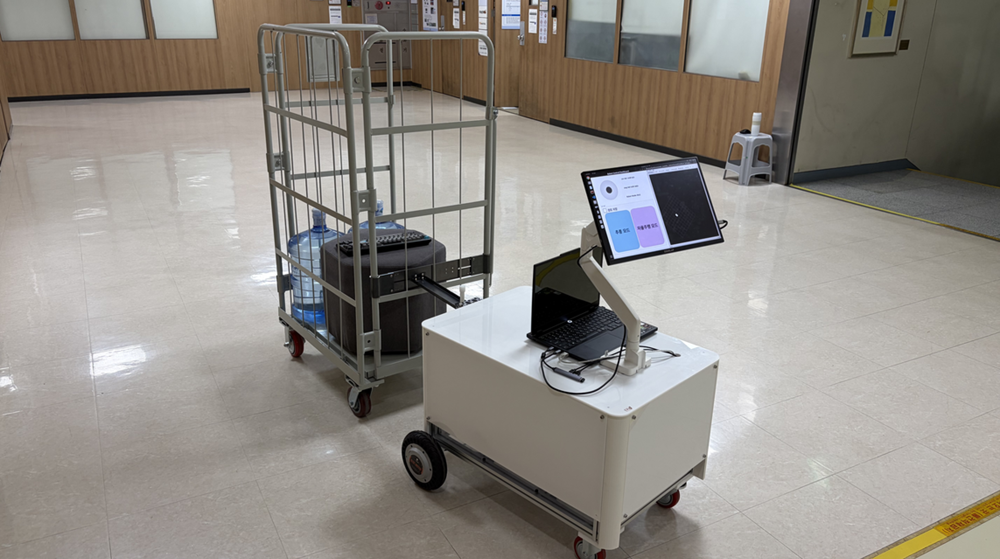
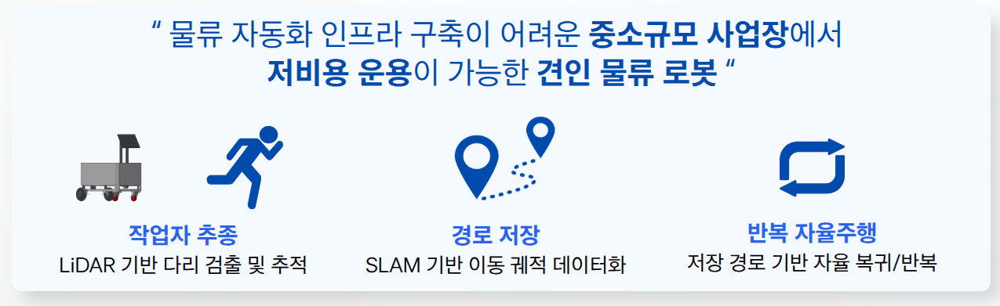
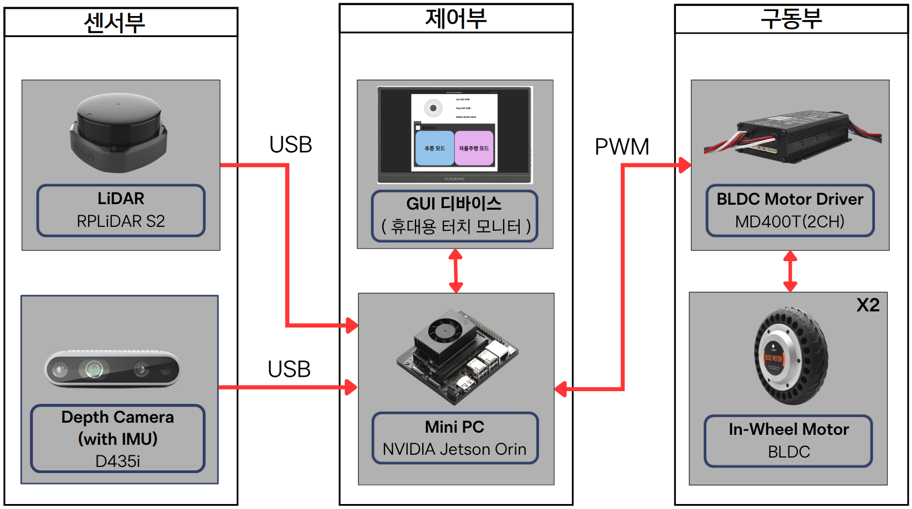
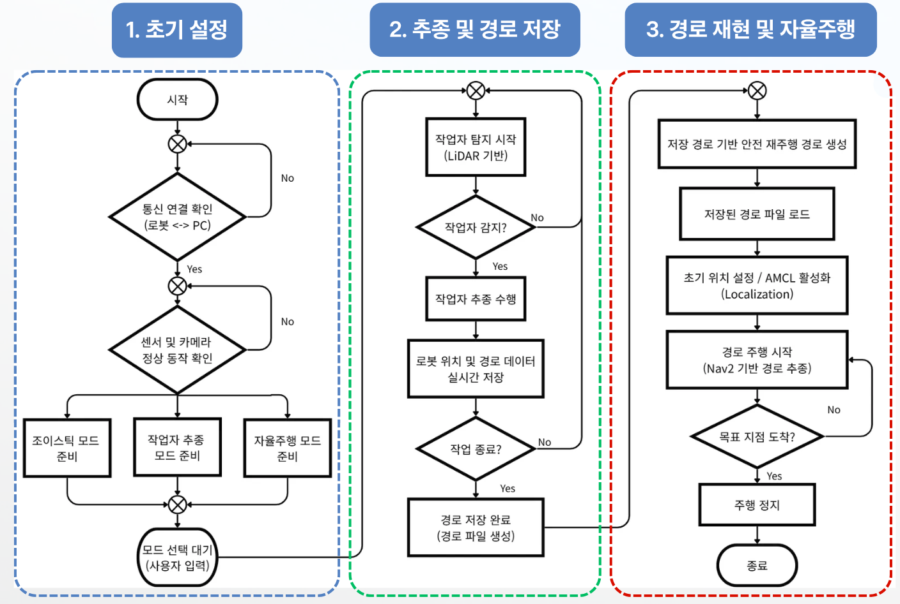
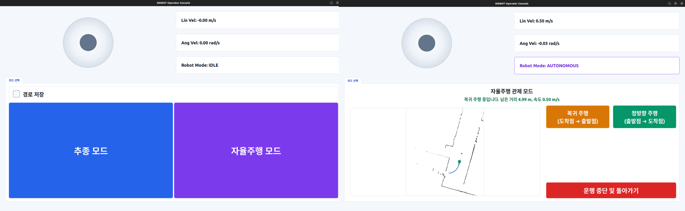
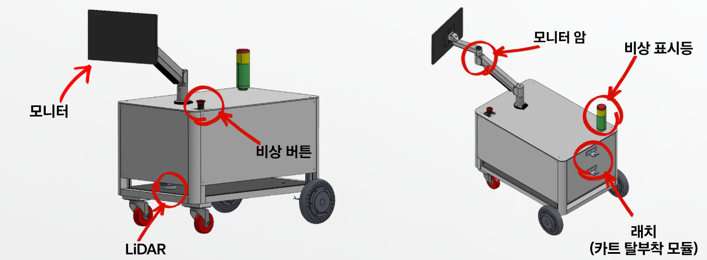
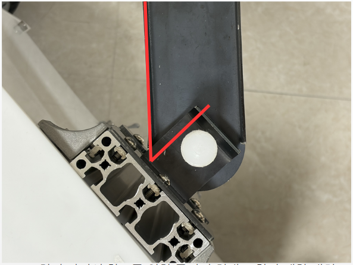

# Autonomous Following and Towing Robot (AFTR)

> **작업자 추종·경로 기록·자율주행을 통합한 ROS 2 기반 견인 로봇**


---

## 1. 프로젝트 개요

### 1-1. 프로젝트 소개

- **프로젝트명:** Autonomous Following and Towing Robot (AFTR)
- **프로젝트 정의:** LiDAR 기반으로 작업자를 추종하면서 경로와 지도를 기록하고, 저장된 정보를 활용하여 자율주행과 복귀 주행을 수행하는 ROS 2 기반 이동형 견인 로봇

<p align="center">
  
</p>

<p align="center">
  
</p>

### 1-2. 개발 배경 및 필요성

중소규모 사업장에서는 작업자 이동에 맞춰 물품을 운반하거나 지정된 경로를 반복 이동해야 하는 작업이 발생합니다. 고정된 물류 자동화 설비를 도입하기 어려운 환경에서도 활용할 수 있도록, **작업자 추종과 이동 경로의 재사용**을 하나의 로봇에 통합하는 것을 목표로 개발했습니다.

### 1-3. 프로젝트 특장점

- **추종과 경로 기록의 연계:** 작업자를 추종하는 동안 이동 경로와 지도를 기록
- **저장 경로 재사용:** 기록한 경로를 기반으로 정방향 및 복귀 주행 지원
- **운용 흐름 통합:** 추종, 기록, 정렬, 위치 추정, 경로 재생을 Mode Manager에서 관리
- **운영자 중심 인터페이스:** GUI, 안내음, 상태 LED로 운용 상태 확인
- **안전 상태 관리:** 낙상 감지 및 detector heartbeat 상태를 활용한 안전 정지 절차

### 1-4. 주요 기능

| 기능 | 설명 |
| --- | --- |
| 작업자 추종 | LiDAR 기반 작업자 탐지 및 추종 |
| 경로 기록 | 추종 중 위치·이동 경로 저장 및 SLAM 지도 작성 |
| 위치 추정 | 저장된 지도와 AMCL을 이용한 위치 추정 |
| 경로 재생 | Nav2 및 Path Manager를 통한 정방향·복귀 주행 |
| 안전 모니터링 | 낙상 감지, detector 상태 감시 및 안전 정지 |
| 운영자 GUI | 모드 선택, 상태·속도 표시, 지도 시각화 및 주행 제어 |

### 1-5. 기대 효과 및 활용 분야

작업자 이동과 반복 운반 작업을 보조하여 수동 운반 부담을 줄이고, 별도의 고정 물류 인프라 구축이 어려운 공간에서도 경로 재사용 기반 운용을 시도할 수 있습니다. **활용 분야**로는 중소규모 사업장 내 물품 운반, 실내 견인 작업, 자율이동 로봇 교육·연구 등을 고려할 수 있습니다.

위 내용은 기대 효과와 활용 가능성을 설명하며, 정량적인 생산성 향상 또는 범용 환경 성능을 검증했다는 의미는 아닙니다.

### 1-6. 기술 스택

| 구분 | 사용 기술 및 장비 |
| --- | --- |
| 로봇 플랫폼 | ROS 2 Humble, ros2_control |
| 지도 및 자율주행 | SLAM Toolbox, Nav2, AMCL |
| 센서 | RPLIDAR S2, Intel RealSense D435i |
| 구동계 | MD400T BLDC Motor Driver, In-Wheel Motor × 2 |
| 운영자 인터페이스 | Qt 기반 Operator GUI, Audio, Status LED |
| 배포 환경 | Docker, Linux amd64 Laptop, NVIDIA Jetson Orin Nano |

---

## 2. 팀원 소개

| 구분 | 역할 | 담당 영역 |
| --- | --- | --- |
| 멘티 1 | Firmware 및 System Integration | `aftr_audio`, `aftr_bringup`, `aftr_description`, `aftr_gui`, `aftr_hardware`, `aftr_mode_manager`, `aftr_navigation`, `aftr_slam`, `aftr_teleop` |
| 멘티 2 | Path Planning 및 Autonomous Navigation Support | `aftr_path_manager`, `aftr_status_led` |
| 멘티 3 | Mechanical Design | 기구부 설계 및 CAD |
| 멘티 4 (팀장) | Leg Tracking 및 Fall Detection | `aftr_tracking`, `aftr_fall_detection` |

---

## 3. 시스템 구성도

### 3-1. 하드웨어 및 시스템 구성

<p align="center">
  
</p>

LiDAR와 Depth Camera에서 수집한 데이터를 기반으로 추종·지도 작성·주행 제어 기능을 수행하며, MD400T Driver를 통해 BLDC In-Wheel Motor를 제어합니다.

### 3-2. 소프트웨어 운용 흐름

<p align="center">
  
</p>

1. **초기 설정:** 통신, 센서, 구동계 연결 상태 확인
2. **추종 및 경로 저장:** 작업자 추종과 이동 경로·지도 기록
3. **경로 재현 및 자율주행:** 위치 추정 후 저장 경로의 정방향·복귀 주행

### 3-3. 운영자 GUI

<p align="center">
  
</p>

GUI에서 모드 선택, 경로 저장 설정, 주행 명령, 로봇 상태 및 지도 정보를 확인할 수 있습니다.

### 3-4. 기구 설계

<p align="center">
  
</p>

<p align="center"><sub>로봇 주요 구성 요소 및 디스플레이 거치 구조</sub></p>

<p align="center">
  
</p>

<p align="center"><sub>작업 카트와 로봇을 연결하는 기계적 결합 구조</sub></p>

---

## 4. 작품 소개영상

[](https://youtu.be/bFqfijlAvS0)

[YouTube에서 작품 소개영상 보기](https://youtu.be/bFqfijlAvS0)

---

## 5. 핵심 소스코드

### 5-1. 경로 재생 이벤트 판정

[`aftr_mode_manager/workflow/path_events.py`](aftr_mode_manager/aftr_mode_manager/workflow/path_events.py)

경로 재생 상태 메시지에서 장애물로 인한 일시적인 차단과 더 이상 자동 복구할 수 없는 종료 실패를 구분하는 함수입니다.

```python
def is_terminal_path_failure_event(event) -> bool:
    normalized = str(event).strip().lower()
    return (
        normalized == "goal_rejected"
        or normalized.startswith("aborted_status_")
        or normalized.startswith("failed:")
        or (
            normalized.startswith("blocked:")
            and "retry limit" in normalized
        )
    )
```

이 판정 결과는 Mode Manager의 경로 재생 상태 처리에 사용됩니다. 자세한 상태 전이와 안전 정책은 [시스템 구조](docs/architecture.md), [안전 정책](docs/safety.md)을 참고하세요.

### 5-2. 모터 통신 패킷 생성

[`aftr_hardware/src/md_packet.cpp`](aftr_hardware/src/md_packet.cpp)

MD400T Driver에 전달하는 패킷은 헤더, 장치 ID, 명령 ID, 데이터 길이, 데이터 및 체크섬으로 구성됩니다.

```cpp
std::vector<uint8_t> MDPacket::createPacket(
    PID pid, const std::vector<uint8_t>& data)
{
  std::vector<uint8_t> packet;
  packet.emplace_back(HEADER_RMID);
  packet.emplace_back(HEADER_TMID);
  packet.emplace_back(DRIVER_ID);
  packet.emplace_back(static_cast<uint8_t>(pid));
  packet.emplace_back(static_cast<uint8_t>(data.size()));
  packet.insert(packet.end(), data.begin(), data.end());
  packet.emplace_back(calcCheckSum(packet));
  return packet;
}
```

패킷 형식 및 Checksum의 상세 내용은 [하드웨어 참고 문서](aftr_hardware/docs/md_packet_protocol.md)를 참고하세요.

---

## 설치 및 실행

본 저장소는 **13개 AFTR ROS 패키지**와 별도 외부 패키지를 사용하는 ROS 2 Workspace 프로젝트입니다. 먼저 Linux Host에 Git과 Docker Engine을 준비하세요.

```bash
mkdir -p ~/ros2_ws/src
cd ~/ros2_ws/src

git clone --branch devel https://github.com/nayana224/26_HC281.git autonomous-following-towing-robot
git clone https://github.com/roverrobotics-forks/serial-ros2.git
git clone https://github.com/Slamtec/sllidar_ros2.git
```

`laser_filters`도 같은 `src/`에 별도로 준비해야 합니다. 프로젝트용 fork와 검증된 revision은 추후 확정할 예정입니다.

**Laptop (amd64 / CPU)** — 저장소 디렉터리에서:

```bash
cd ~/ros2_ws/src/autonomous-following-towing-robot
./scripts/docker_build_laptop.sh
./scripts/docker_run_laptop.sh
```

Container 내부에서:

```bash
./src/autonomous-following-towing-robot/scripts/build_ws.sh
source /workspace/install_laptop/setup.bash
```

**Jetson (arm64 / CUDA)** — Jetson Host에서:

```bash
cd ~/ros2_ws/src/autonomous-following-towing-robot
./scripts/docker_build_jetson.sh
./scripts/docker_run_jetson.sh
```

Container 내부에서:

```bash
./src/autonomous-following-towing-robot/scripts/build_ws.sh
source /workspace/install_jetson/setup.bash
```

빌드 완료 후 실제 로봇의 Operator GUI는 Jetson Host에서 실행합니다.

```bash
./scripts/docker_run_jetson.sh bash -lc \
  'ros2 launch aftr_gui operator_system.launch.py'
```

> [!IMPORTANT]
> 실제 로봇 운용 전 모터·센서 연결, 견인 구조, 주변 장애물, 비상 정지 수단을 확인하고 반드시 현장 운영자의 감독 아래 실행하세요.

모델 파일, 장치 별칭 및 데이터 경로 등 자세한 설치 조건은 [설치 및 실행](docs/setup.md)을 참고하세요.

## ROS 패키지

| 패키지 | 역할 |
| --- | --- |
| `aftr_audio` | 음향 및 상태 안내 |
| `aftr_bringup` | 로봇 기본 시스템과 LiDAR 실행 |
| `aftr_description` | URDF / Xacro 로봇 모델 |
| `aftr_fall_detection` | 낙상 감지 및 heartbeat |
| `aftr_gui` | 운영자 GUI |
| `aftr_hardware` | ros2_control 하드웨어 인터페이스 |
| `aftr_mode_manager` | 운용 흐름 및 안전 상태 관리 |
| `aftr_navigation` | Nav2 및 위치 추정 설정 |
| `aftr_path_manager` | 경로 기록·재생 및 위치 데이터 저장 |
| `aftr_slam` | SLAM Toolbox 설정 |
| `aftr_status_led` | 상태 표시 LED |
| `aftr_teleop` | 수동 `/cmd_vel` 제어 |
| `aftr_tracking` | 작업자 추종 |

## 참고 문서

- [설치 및 실행](docs/setup.md)
- [운용 안내](docs/operation.md)
- [시스템 구조](docs/architecture.md)
- [ROS 인터페이스](docs/interfaces.md)
- [안전 정책](docs/safety.md)
- [개발 및 유지보수](docs/maintenance.md)
- [팀 구성 및 담당 영역](docs/team.md)
- [하드웨어 및 발표 참고 자료](docs/references/README.md)
