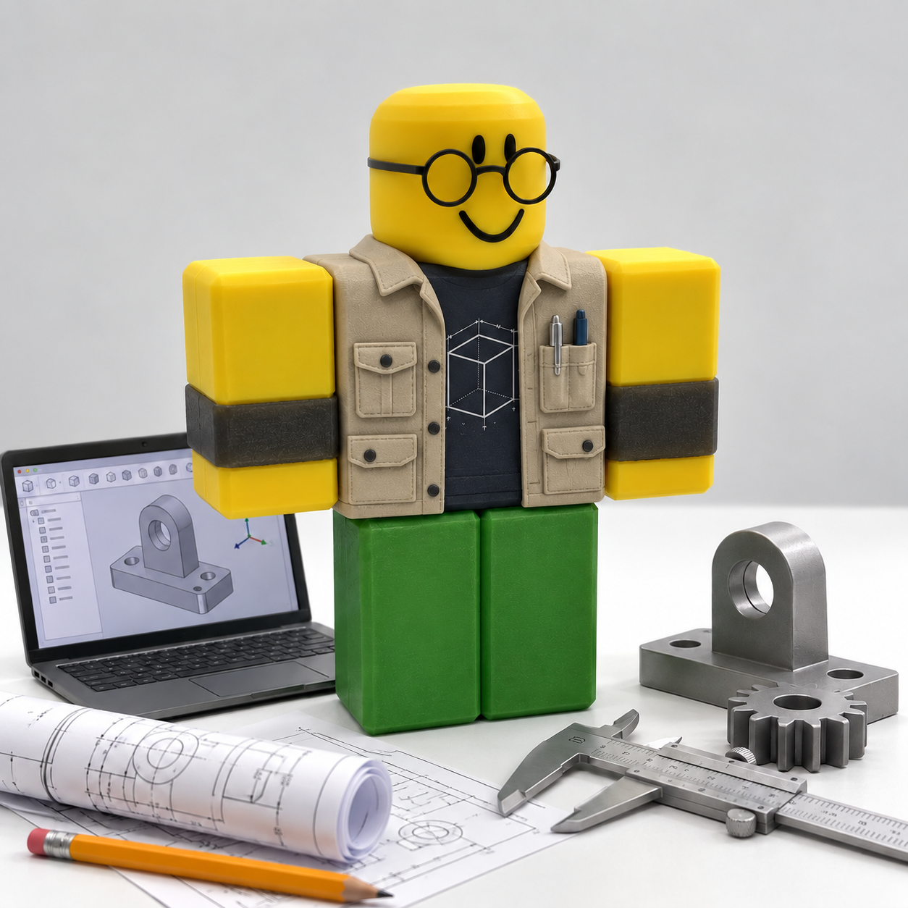

# 팀 구성 및 역할

|  |  |  |  |  |
| :---: | :---: | :---: | :---: | :---: |
| **팀장** | **팀원1** | **팀원2** | **팀원3** | **멘토** |
| Leg Tracking Fall Detection | Path Planning Autonomous Navigation Support | Firmware System Integration | Mechanical Design | 프로젝트 멘토링 |
